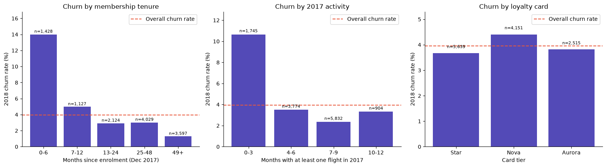
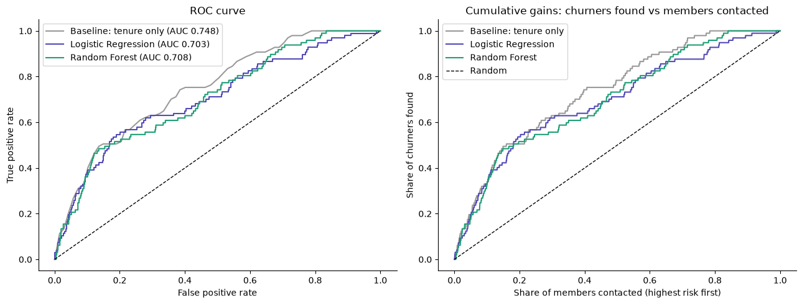
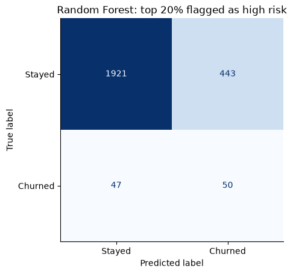
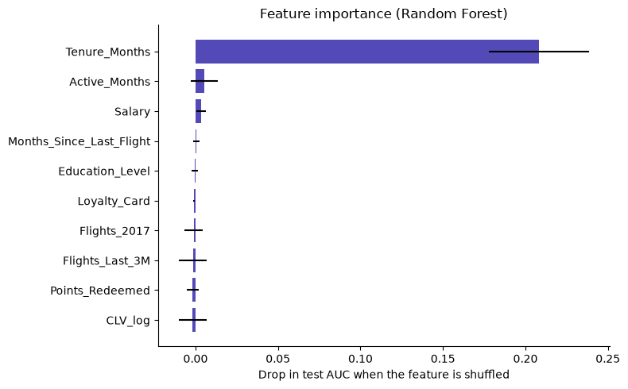
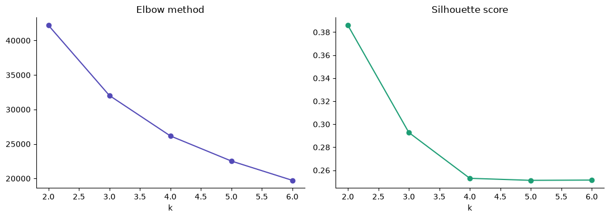
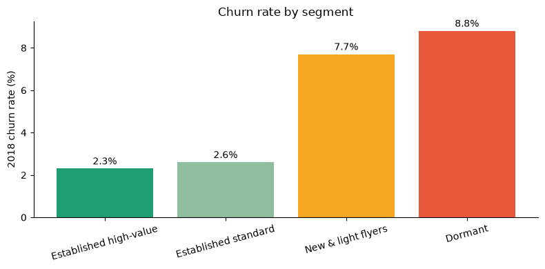

# Airline Loyalty Program: Churn Prediction & Customer Segmentation

An end-to-end customer analytics and machine learning project that uses historical airline loyalty and flight activity data to identify members at risk of cancelling their membership, understand different customer groups, and recommend targeted retention actions.

> **Core finding:** churn is strongly associated with short membership tenure. New and light flyers account for the largest share of churners, while established members have comparatively low cancellation rates. A simple tenure-only baseline performs similarly to the more complex models, making model simplicity an important part of the business conclusion.

---

## Table of contents

- [Business problem](#business-problem)
- [Project objectives](#project-objectives)
- [Dataset](#dataset)
- [Repository structure](#repository-structure)
- [Methodology](#methodology)
- [Key results](#key-results)
- [Customer segments](#customer-segments)
- [Business recommendations](#business-recommendations)
- [How to run the project](#how-to-run-the-project)
- [Tools and libraries](#tools-and-libraries)
- [Important limitations and interpretation notes](#important-limitations-and-interpretation-notes)
- [Future improvements](#future-improvements)

## Business problem

Airline loyalty programmes depend on retaining members and encouraging repeat flight activity. The business needs to:

1. Identify members who are more likely to cancel their loyalty membership.
2. Understand the behavioural and value-based differences between members.
3. Prioritise limited retention-marketing resources.
4. Translate analytical findings into practical, measurable retention campaigns.

This project addresses the problem through two complementary approaches:

- **Churn prediction:** estimates which active members are more likely to cancel during 2018.
- **Customer segmentation:** groups members according to tenure, flight activity, inactivity, and customer lifetime value (CLV), without using the churn outcome to form the clusters.

## Project objectives

- Explore and clean the loyalty-history and monthly flight-activity datasets.
- Define a forward-looking churn target using 2018 cancellation records.
- Build customer-level features using 2017 information only.
- Compare a tenure-only baseline, Logistic Regression, and Random Forest.
- Evaluate performance with metrics suited to an imbalanced classification problem.
- Generate out-of-fold churn risk scores and High / Medium / Low risk tiers.
- Use K-Means clustering to identify four interpretable customer segments.
- Recommend retention actions and measurement plans for each segment.

## Dataset

The notebook works with two source datasets and produces one scored customer-level output.

| File | Description | Original rows × columns |
|---|---|---:|
| `Customer Loyalty History.csv` | One row per loyalty-program member; includes profile, enrolment, CLV, and cancellation information | 16,737 × 16 |
| `Customer Flight Activity.csv` | Monthly flight activity and points information for 2017–2018 | 392,936 × 8 |
| `airline_customer_risk_and_segments.csv` | Final member-level risk scores, risk tiers, segments, target, and model features | 12,305 × 15 |

### Important source fields

**Loyalty history**
- `Loyalty Number`: member identifier used to join the files.
- `Country`, `Province`, `City`, `Gender`, `Education`, `Marital Status`: member profile information.
- `Salary`, `CLV`, `Loyalty Card`, `Enrollment Type`: member attributes.
- `Enrollment Year`, `Enrollment Month`: membership start date.
- `Cancellation Year`, `Cancellation Month`: recorded membership cancellation date.

**Flight activity**
- `Loyalty Number`: member identifier.
- `Year`, `Month`: activity period.
- `Total Flights`, `Distance`: flight activity measures.
- `Points Accumulated`, `Points Redeemed`, `Dollar Cost Points Redeemed`: loyalty-points measures.

### Data preparation performed in the notebook

- Removed **1,922 exact duplicate rows** from the flight-activity file.
- Converted **20 negative salary values** to their absolute values, treating them as sign errors.
- Filled **4,238 missing salary values** with zero after confirming that all belonged to members whose education category was `College`.
- Retained missing cancellation dates as the representation of members without a recorded cancellation.
- Did not use `Points Accumulated` as a model feature because it equalled `Distance` in 98.6% of source rows.
- Joined the files using `Loyalty Number`; all 16,737 loyalty members were present in the flight-activity file.

The notebook also found 3,222 flight records with positive flights dated before the member's recorded enrolment date. These records were left unchanged because the notebook could not establish which date was incorrect. See the limitations section.

## Methodology

### 1. Define the prediction population and churn

The analysis scores members who were active on **1 January 2018**:

- Excludes members who enrolled during 2018.
- Excludes members who had already cancelled before 2018.
- Defines `churned = 1` when the member's recorded cancellation year is 2018; otherwise `churned = 0`.

| Population measure | Result |
|---|---:|
| Members in the original loyalty file | 16,737 |
| Enrolled during 2018 | 3,010 |
| Already cancelled before 2018 | 1,422 |
| Members eligible for scoring | **12,305** |
| Cancelled during 2018 | **486** |
| 2018 churn rate | **3.95%** |

### 2. Use a time-based feature design

The project uses **2017 information to predict cancellations during 2018**. This is designed to prevent the model from using same-period or future flight activity to predict the outcome.

```text
January 2017                 December 2017 | January 2018             December 2018
       FEATURE WINDOW                       |       OUTCOME WINDOW
  Flight behaviour and profile               |  Did the member cancel?
```

### 3. Feature engineering

Ten features are created for each eligible member.

| Feature | Meaning |
|---|---|
| `Tenure_Months` | Membership duration calculated as of December 2017 |
| `Flights_2017` | Total flights recorded during 2017 |
| `Active_Months` | Positive-flight activity rows counted by the notebook during 2017 |
| `Flights_Last_3M` | Flights recorded in October–December 2017 |
| `Months_Since_Last_Flight` | Months since the last positive-flight record, measured at the end of 2017; set to 12 when no 2017 flights are recorded |
| `Points_Redeemed` | Points redeemed during 2017 |
| `CLV_log` | Log-transformed customer lifetime value |
| `Salary` | Salary after the cleaning steps |
| `Loyalty_Card` | Encoded card category: Star = 0, Nova = 1, Aurora = 2 |
| `Education_Level` | Ordered education encoding from 0 to 4 |

Gender, marital status, and province were not included in the model because the notebook's exploratory analysis found their churn rates close to the overall rate.

### 4. Exploratory data analysis

The exploratory analysis compares churn rates across membership tenure, flight activity, and loyalty-card categories, then checks demographic groups.



Main observations from the notebook:

- Members in their first six months had a **14.0%** churn rate.
- Members with 49 or more months of tenure had a **1.3%** churn rate.
- Members active in three or fewer months had a **10.7%** churn rate.
- Loyalty-card category showed little separation: Star 3.7%, Nova 4.4%, and Aurora 3.8%.
- Gender, marital status, and education groups were relatively close to the overall 3.95% churn rate.

### 5. Model development

Three approaches are compared:

1. **Baseline – tenure only:** Logistic Regression using `Tenure_Months` alone. This tests whether a simple feature already captures most of the signal.
2. **Logistic Regression:** uses all ten engineered features and `class_weight="balanced"`.
3. **Random Forest:** uses all ten features, 300 trees, maximum depth 4, minimum leaf size 40, and `class_weight="balanced"`.

The notebook uses:
- An 80/20 stratified train-test split (`random_state=42`).
- Five-fold stratified cross-validation on the training data.
- ROC-AUC, PR-AUC, and the share of churners found in the top 20% of risk scores.
- Accuracy is not used as the primary metric because only 3.95% of eligible members churned.

### 6. Model evaluation

| Model | Train CV ROC-AUC (mean ± SD) | Test ROC-AUC | Test PR-AUC | Churners found in top 20% | Lift vs. random |
|---|---:|---:|---:|---:|---:|
| Tenure-only baseline | 0.713 ± 0.026 | **0.748** | 0.119 | 50.5% | 2.53× |
| Logistic Regression | 0.709 ± 0.023 | 0.703 | **0.114** | **53.6%** | **2.68×** |
| Random Forest | **0.727 ± 0.020** | 0.708 | 0.102 | 51.5% | 2.58× |

Random contact of 20% of members would find approximately 20% of churners. The models find around 50–54% in that same contact group.



**Model selection:** Random Forest is selected for risk-tier creation because it has the highest mean cross-validated ROC-AUC on the training data (0.727). It is not the best on every test metric: the tenure-only baseline has the highest test ROC-AUC, while Logistic Regression catches the largest share of churners in the top 20%. The differences should be interpreted cautiously because the test set contains only 97 churners.

Using the selected Random Forest model and flagging the top 20% of test members:

- Members flagged: **493 of 2,461**
- Precision: **10.1%**
- Test-set churn base rate: **3.9%**
- Recall: **51.5%**



### 7. Feature importance

Permutation importance is calculated on the test set using ROC-AUC and 20 repeats.



`Tenure_Months` is the dominant feature: shuffling it reduces test AUC by approximately **0.208**. The other features have values close to zero in this run. This suggests that, once tenure is known, the other model features add little unique predictive information in this dataset. Small or negative permutation values do not prove that a feature is universally useless.

### 8. Risk tiers

The selected Random Forest model generates **out-of-fold predictions** for all 12,305 eligible members. Each member's risk score is produced by a fold model that did not train on that member. The notebook then assigns:

- **High:** top 10% of risk scores.
- **Medium:** next 20%.
- **Low:** remaining 70%.

| Risk tier | Members | 2018 churners | 2018 churn rate | Share of all churners |
|---|---:|---:|---:|---:|
| High | 1,231 | 173 | **14.1%** | 35.6% |
| Medium | 2,461 | 115 | **4.7%** | 23.7% |
| Low | 8,613 | 198 | **2.3%** | 40.7% |

The High tier represents 10% of members and has a churn rate about 3.6 times the overall rate. However, 40.7% of all churners are still in the Low tier, so the scores should be used to prioritise outreach rather than to make definitive claims about an individual member.

## Customer segments

K-Means clustering is used to answer a different question from churn prediction: **what types of members are in the programme?**

The clustering features are:
- `Tenure_Months`
- `Flights_2017`
- `Active_Months`
- `Months_Since_Last_Flight`
- `CLV_log`

Features are standardised before clustering. The churn target is **not** used to create the clusters; churn rates are examined afterwards as an independent profile check.

The notebook compares k values from 2 to 6. The silhouette score is highest at k=2 (0.386), while k=4 has a score of approximately 0.253. The notebook chooses **k=4 for business interpretability**, to distinguish established members by value as well as separate new/light and dormant members. The segments are not sharply separated.



### Four customer segments

| Segment | Members | Share of members | Average tenure (months) | Average 2017 flights | Average CLV | 2018 churn rate | Share of all churners |
|---|---:|---:|---:|---:|---:|---:|---:|
| Established high-value | 3,958 | 32.2% | 39.3 | 20.7 | 13,399 | 2.3% | 18.7% |
| Established standard | 4,960 | 40.3% | 40.7 | 21.0 | 4,153 | 2.6% | 26.1% |
| New & light flyers | 2,774 | 22.5% | 13.7 | 9.8 | 6,871 | **7.7%** | **44.0%** |
| Dormant | 613 | 5.0% | 26.6 | 0.2 | 8,380 | **8.8%** | 11.1% |



### Segment insights

- **New & light flyers** are 22.5% of members but account for 44.0% of all churners. They are the largest opportunity by churn volume.
- **Dormant members** have the highest segment churn rate (8.8%), but make up only 5.0% of members.
- **Established high-value** and **Established standard** members have similarly low churn rates (2.3% and 2.6%).
- High CLV alone does not identify churn risk: the established high-value group is valuable but does not have a higher observed churn rate than the established standard group.

## Business recommendations

These are recommendations based on observed associations, not interventions whose causal impact has already been proven.

| Segment | Suggested action | How to measure |
|---|---|---|
| New & light flyers | Prioritise onboarding during the first 12 months. Consider a second/third-flight incentive, a first-redemption nudge, and check-ins around months 3 and 6. Start with the 896 members who are both New & light and High risk. | 12-month retention of new-member cohorts |
| Dormant | Test a low-cost win-back message or bonus-points offer. Keep the incentive cost controlled because reactivation is uncertain. | Reactivation within 90 days |
| Established high-value | Focus on recognition and service benefits rather than broad discounts. Monitor for a sudden fall in activity. | Churn rate and spend per member |
| Established standard | Use low-cost automated nurture campaigns to encourage additional flights or redemptions. | Change in flights per member |

**Measurement recommendation:** run each campaign as an A/B test with a holdout group. Compare retention and incremental value between treatment and holdout groups before attributing any churn reduction to the campaign.

## How to run the project

### 1. Clone the repository

```bash
git clone <your-repository-url>
cd airline-loyalty-churn-prediction
```

### 2. Arrange the files

Place the notebook and source CSV files in the repository root, or place the CSVs in a `data/` folder. Use the canonical filenames expected by the notebook:

```text
Customer Loyalty History.csv
Customer Flight Activity.csv
```

The notebook also checks a small set of alternate filenames. If your downloaded filenames differ, rename them to the canonical names above.

### 3. Install dependencies

```bash
pip install -r requirements.txt
```

If you do not have a `requirements.txt` yet, install the libraries used by the notebook:

```bash
pip install pandas numpy matplotlib scikit-learn jupyter
```

### 4. Run the notebook

```bash
jupyter notebook
```

Open `Airline_Loyalty_Churn_and_Segmentation.ipynb` and run the cells from top to bottom.

The final notebook cell exports:

```text
airline_customer_risk_and_segments.csv
```

This output contains one row per eligible member and includes the loyalty number, segment, risk tier, risk score, churn label, and engineered model features.

## Repository structure

A suggested GitHub layout:

```text
airline-loyalty-churn-prediction/
│
├── IMAGES/
│   ├── 01_churn_patterns.png
│   ├── 02_model_performance.png
│   ├── 03_top20_risk_confusion_matrix.png
│   ├── 04_permutation_feature_importance.png
│   ├── 05_kmeans_selection.png
│   └── 06_churn_by_customer_segment.png
│
├── Airline_Loyalty_Churn_and_Segmentation (1).ipynb
├── Customer Flight Activity (1).csv
├── Customer Loyalty History (1).csv
├── airline_customer_risk_and_segments.csv
└── README.md
```

If you prefer to keep datasets out of GitHub, add them to `.gitignore` and explain how to obtain the source files. Do not publish personal or restricted data without permission.

## Tools and libraries

- **Python** – project programming language
- **Pandas** – data loading, cleaning, joining, and feature engineering
- **NumPy** – numerical operations
- **Matplotlib** – visualisation
- **Scikit-learn** – preprocessing, Logistic Regression, Random Forest, cross-validation, evaluation, permutation importance, and K-Means
- **Jupyter Notebook** – analysis workflow and documentation

## Important limitations and interpretation notes

1. **Limited outcome period:** the analysis uses one year of cancellation outcomes (2018), with 486 churners overall and only 97 churners in the test set. Test metrics can vary materially.
2. **Formal cancellation only:** members who quietly stop flying without cancelling are not labelled as churners.
3. **Short flight history:** flight activity is available only for 2017 and 2018.
4. **Pre-enrolment flight records:** the source contains 3,222 positive-flight records dated before the recorded enrolment date. The notebook leaves them unchanged.
5. **Snapshot timing is unclear:** the exact reference date for profile variables such as salary, loyalty-card tier, and CLV is not established in the source.
6. **Activity-month implementation needs review:** the notebook's `Active_Months` feature counts positive-flight rows, not distinct calendar months. The source has multiple records for some member-year-month combinations, so this feature can exceed 12 (the notebook's observed maximum is 20). Before using this pipeline operationally, aggregate by member and calendar month or count distinct months, then rerun the models and clustering.
7. **Moderate cluster separation:** the k=4 silhouette score is about 0.253. The segments are useful working profiles, not naturally isolated customer types.
8. **Association is not causation:** the analysis identifies patterns associated with cancellation; it does not establish why a member cancelled or prove that a retention offer will prevent cancellation.
9. **No later-period validation:** the model has not been tested on a later year or on a separate airline/customer population.

## Future improvements

- Correct the `Active_Months` calculation by counting distinct months with positive flight activity, then rerun the complete pipeline.
- Aggregate multiple flight records within each member-month consistently before creating monthly features.
- Validate the model on a later cancellation year and monitor performance over time.
- Add survival analysis to model time until cancellation.
- Calibrate predicted probabilities and choose contact thresholds using campaign costs, expected member value, and retention-offer economics.
- Test segment-specific retention strategies through controlled A/B experiments.
- Investigate the pre-enrolment flight records and the reference dates of profile attributes.

---

## Project takeaway

The strongest signal in this analysis is **membership tenure**, not loyalty-card tier or customer value. New and light flyers are the most important retention opportunity by volume, while dormant members have the highest segment-level churn rate. The project demonstrates how statistical exploration, predictive modelling, customer segmentation, and business recommendations can be combined into a practical customer analytics workflow.

